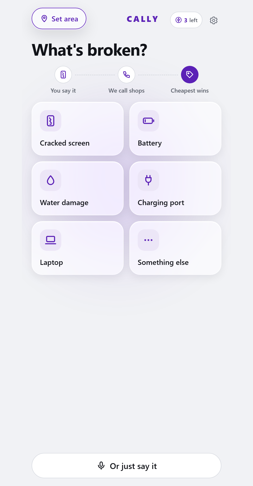

# Cally: an AI agent that calls repair shops for you

**[Try the live demo →](https://callme-ochre.vercel.app)** (works best on a phone)

Getting a phone or laptop fixed means calling shop after shop to ask *"how much, and how long?"*. Cally does that for you. Describe what's broken, and an AI voice agent phones the repair shops near you, asks for a price and turnaround time, and lays the quotes out side by side.



## How it works

1. **Say what's wrong.** Hold the mic and talk, tap a repair type (cracked screen, battery…), or type. Works in English, Thai or Cantonese.
2. **Pick where.** Drop a pin on the map and set a 1–20 km radius. Real shops come from Google Places, and anything outside the radius is excluded.
3. **Cally makes the calls.** Claude turns your request into a short call brief. An ElevenLabs voice agent calls each shop over a SIP phone line and asks the questions, in Thai or English.
4. **Compare quotes.** Claude reads each call transcript and pulls out the price and wait time, so you see one clean comparison.

> **Demo mode:** the public demo uses real shop listings, but the calls and prices are simulated so nobody's phone rings. Real calls were tested against a test number.

## Tech

| | |
|---|---|
| App | Next.js (App Router), TypeScript, deployed on Vercel |
| AI | Claude (Haiku) for parsing requests and summarizing call transcripts |
| Voice calls | ElevenLabs conversational agent, outbound over a Vonage SIP number |
| Places | Google Places for real shop listings, OpenStreetMap for the location picker |

## What I worked on

- **Original app:** the request → call → quote flow, the Speak screen, wiring Claude and the direct ElevenLabs/Vonage calling path.
- **Hold-to-talk mic.** Press and hold to speak, release to send.
- **Radius enforcement.** Calls only go to shops inside the chosen km range, with a clear message to widen it if none are left.
- **First-time-user pass.** Tested the app as someone who had never seen it, then fixed the 9 biggest points of confusion.
- **Home screen redesign.** Testers thought it was "some AI talking app", so the first screen now shows repair price comparison at a glance.

Built with [@aarush-hitgub](https://github.com/aarush-hitgub), who built the Vonage ↔ ElevenLabs caller, the payment demo, the radius slider and the location-based listings.

## Run it locally

Requires Node.js 24.

```bash
npm ci
npm run dev -- --hostname 127.0.0.1 --port 3200
```

API keys (Anthropic, ElevenLabs, Google Maps) go in `.env.local` and are never committed. Without them the app falls back to demo data. Detailed setup and calling notes are in [docs/SETUP-NOTES.md](docs/SETUP-NOTES.md).
