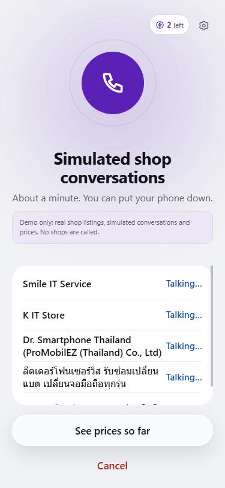
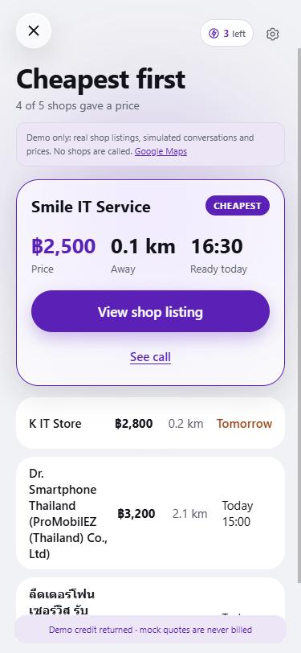

# Cally: an AI agent that calls repair shops for you

**Tell Cally what's broken. It phones the repair shops near you, asks each one for a price and how long it'll take, and shows you the cheapest first.**

[](https://cally-repair.vercel.app)

| 1. Say what's broken | 2. Cally calls nearby shops | 3. Cheapest first |
|:---:|:---:|:---:|
|  |  |  |

## Try it in 1 minute

Works best on a phone, but a laptop is fine too.

1. Open **[cally-repair.vercel.app](https://cally-repair.vercel.app)**.
2. Tap **Cracked screen**.
3. Tap **Type instead**, write *"iPhone 13, need it today"*, and press Enter. You can also hold the mic and say it.
4. Check the details, then tap **Yes, find me a shop**.
5. After about a minute, you get real shops near you, sorted by price.

> **Demo mode:** the shop listings are real (from Google Maps), but the calls and prices are simulated, so no shop's phone actually rings. Real calls work and were tested on a test phone line.

## Why I built it

Getting a phone fixed in Bangkok means calling shop after shop to ask *"how much, and when can it be ready?"*. It's slow and awkward. Cally makes those calls for you, in Thai or English.

## How it works

```
You speak or type ─► Claude turns it into a call brief (device, problem, deadline)
                 ─► Google Places finds repair shops inside your radius
                 ─► ElevenLabs voice agent calls each shop over a phone line
                 ─► Claude reads each call and pulls out price + ready time
                 ─► You see the quotes side by side, cheapest first
```

| Part | Tech |
|---|---|
| App | Next.js, TypeScript, hosted on Vercel |
| Understanding requests and calls | Claude API (Haiku) |
| Phone calls | ElevenLabs voice agent over a Vonage SIP number |
| Finding shops | Google Places, plus OpenStreetMap for the map picker |
| Languages | English, Thai and Cantonese |

## What I worked on

- **The original app:** the request → call → quote flow, the speaking screen, and connecting Claude and the phone calling.
- **Hold-to-talk mic.** Press and hold to speak, release to send.
- **Search radius that's respected.** Calls only go to shops inside the distance you pick. If none are left, you're told to widen it.
- **First-time-user testing.** I used the app as someone who had never seen it, found the 9 most confusing parts, and fixed them.
- **Home screen redesign.** Testers thought it was "some AI talking app", so the first screen now shows *repair → we call shops → cheapest wins* at a glance.

<sub>Co-built with [@aarush-hitgub](https://github.com/aarush-hitgub) (phone-calling engine, payment demo, shop listings).</sub>

## Run it yourself

Requires Node.js 24.

```bash
npm ci
npm run dev -- --hostname 127.0.0.1 --port 3200
```

API keys (Anthropic, ElevenLabs, Google Maps) go in `.env.local` and are never committed. Without them the app falls back to demo data. Full setup and calling notes are in [docs/SETUP-NOTES.md](docs/SETUP-NOTES.md).
